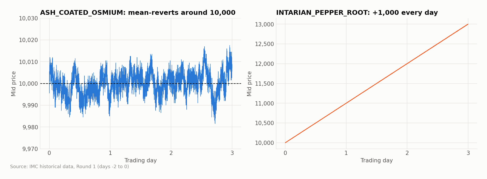
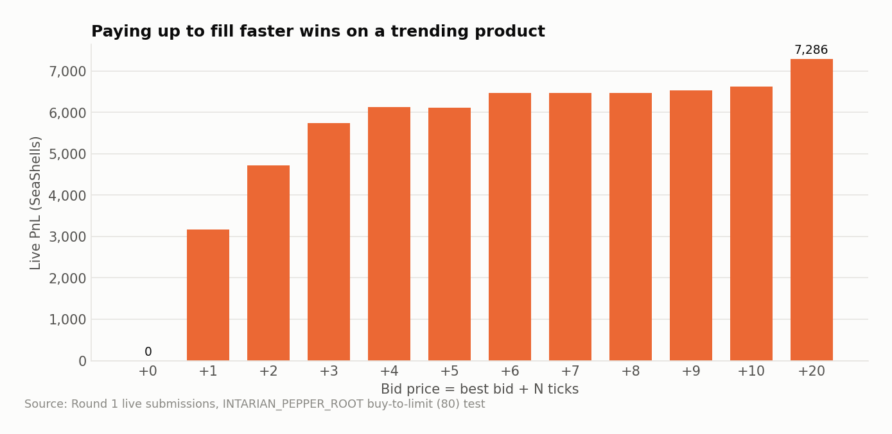
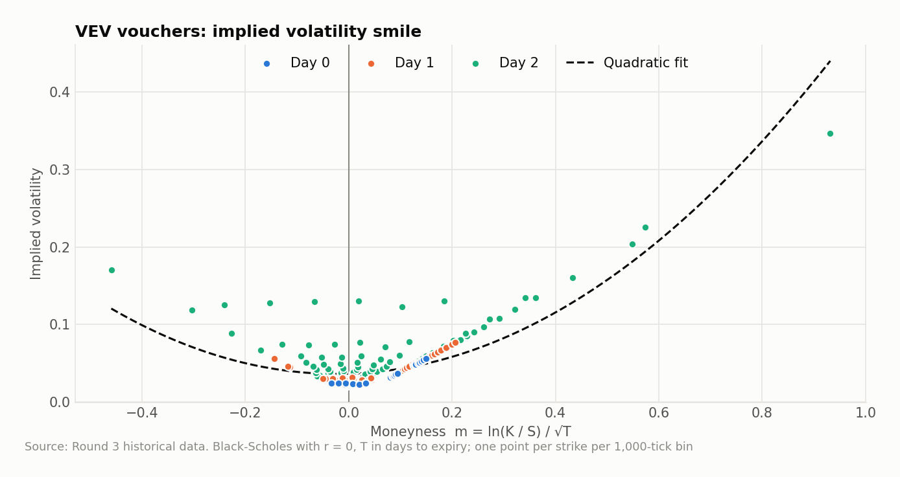
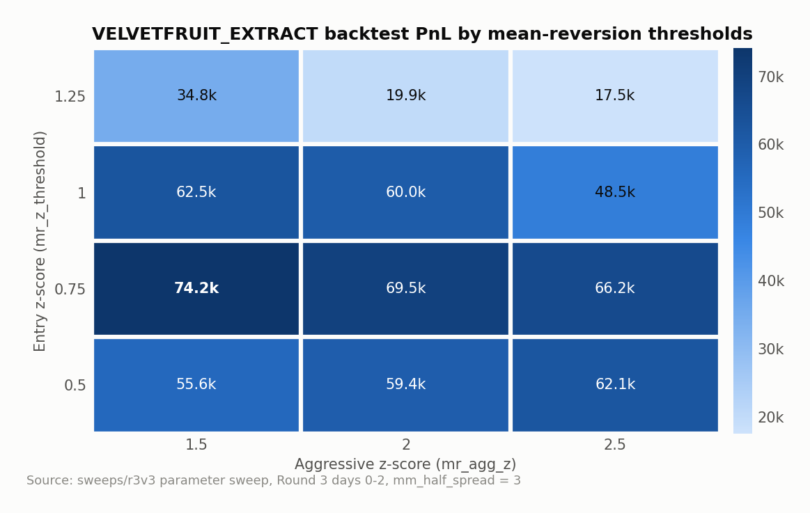
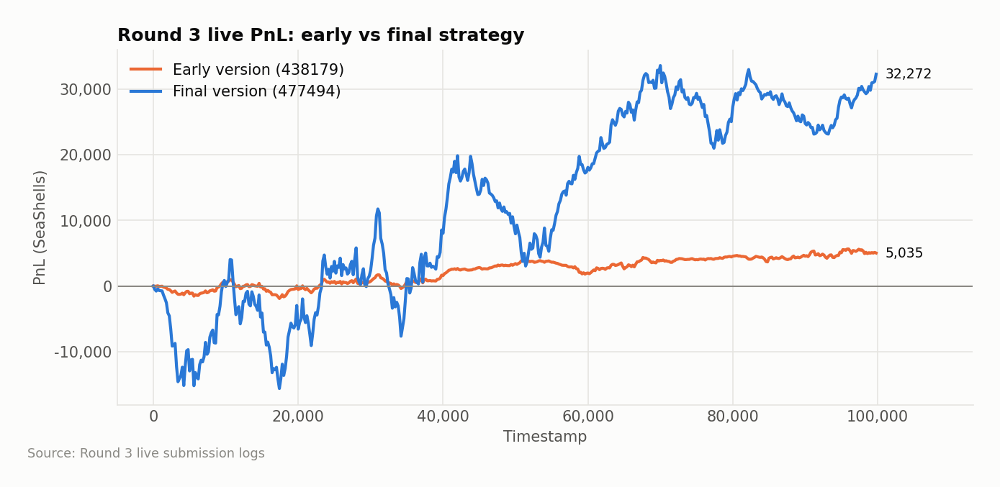
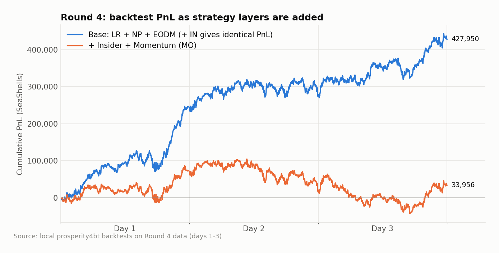
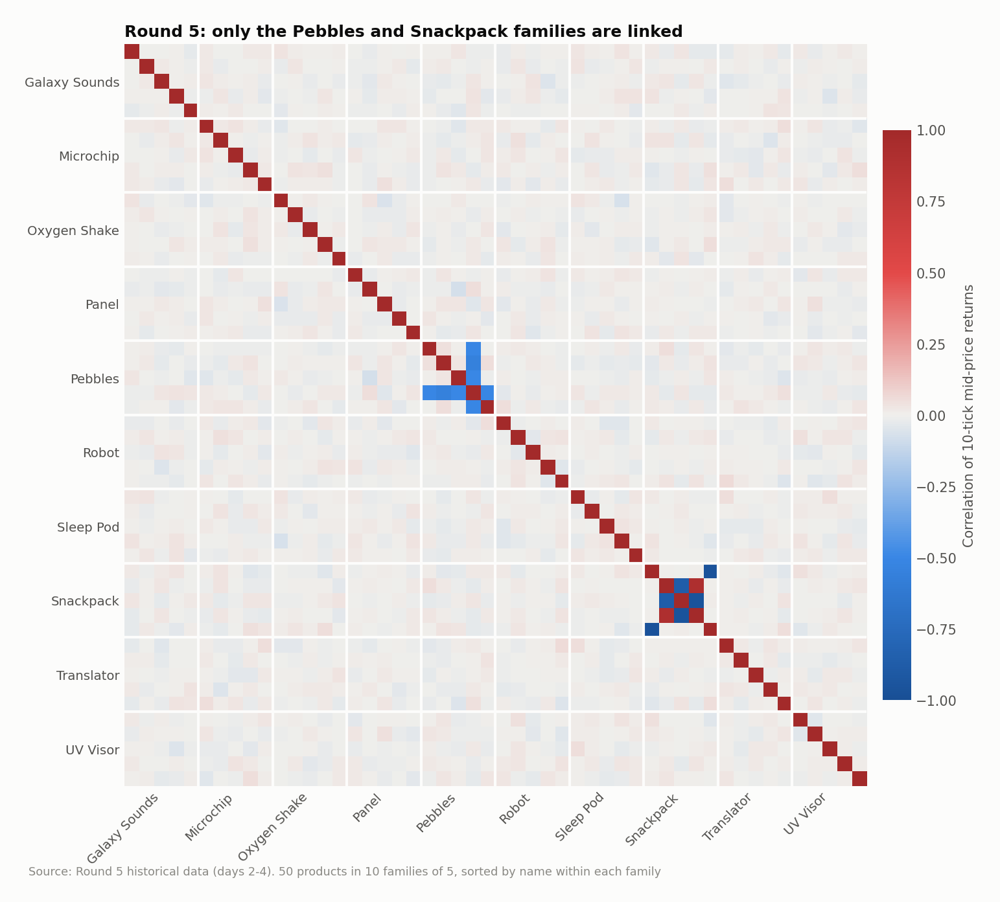
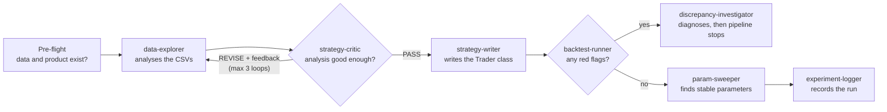

# IMC Prosperity 4 — What the Sigma Trading


Our algorithmic trading code for [IMC Prosperity 4](https://prosperity.imc.com/) (2026): strategies, backtests, parameter sweeps and the research behind them, written up round by round. It covers what worked and also what didn't.

---

## Contents

- [At a glance](#at-a-glance)
- [About the competition](#about-the-competition)
- [Round by round](#round-by-round)
  - [Round 1: Osmium and Pepper Root](#round-1-osmium-and-pepper-root)
  - [Round 2: Same products, plus an auction](#round-2-same-products-plus-an-auction)
  - [Round 3: Hydrogel, Velvetfruit and VEV vouchers](#round-3-hydrogel-velvetfruit-and-vev-vouchers)
  - [Round 4: Layering signals on top](#round-4-layering-signals-on-top)
  - [Round 5: Fifty new products](#round-5-fifty-new-products)
- [Agentic pipeline and AI workflow](#agentic-pipeline-and-ai-workflow)
- [What we learned](#what-we-learned)
- [Repository map](#repository-map)
- [Quick start](#quick-start)
- [Credits](#credits)

---

## At a glance

| Round | Products | Main idea |
|---|---|---|
| 1 | ASH_COATED_OSMIUM, INTARIAN_PEPPER_ROOT | Market making around 10,000; buy-and-hold a product that drifts upward |
| 2 | Same as round 1 | Round 1 strategy carried forward + a sealed-bid auction for extra order flow |
| 3 | HYDROGEL_PACK, VELVETFRUIT_EXTRACT, 10 VEV vouchers | Layered market making + mean reversion; option implied-volatility analysis |
| 4 | Same as round 3 | End-of-day momentum, insider and momentum signals |
| 5 | 50 products in 10 families | Basket market making on Pebbles, pair trading on Snackpack |

---

## About the competition

Prosperity is IMC's yearly trading competition. Each round adds new products to a simulated exchange, and every team submits a Python `Trader` class. The exchange calls `Trader.run(state)` on every tick with the current order book, your positions and recent trades; the method returns the orders to place. Rounds also include a manual trading puzzle.

The constraints that shape every strategy:

- **Only the standard library** (plus the provided `datamodel.py`). No numpy or pandas at submission time.
- **Hard position limits** per product. An order that could breach the limit is rejected entirely.
- **No memory between ticks** except a string (`traderData`) you return and get back next tick, so state is serialised with `json`.

---

## Round by round

### Round 1: Osmium and Pepper Root

**What we saw.** The two products behaved in completely different ways. ASH_COATED_OSMIUM mean-reverts tightly around 10,000 (a few ticks of noise, short half-life), with bots quoting a wide spread. That makes it a natural market-making product. INTARIAN_PEPPER_ROOT rises by almost exactly **+1,000 every day**.



**Strategy.**
- *Osmium:* quote both sides around a fair value built from a rolling median, clamped to 9,995 to 10,005 and adjusted for order-book imbalance. Quotes skew with inventory, and the strategy takes liquidity when the book crosses fair value by enough. Soft and hard inventory caps stop it building a one-sided position.
- *Pepper Root:* the price goes up, so the main job is to get long to the limit (80) as quickly as possible. We ran a live test to measure how much to pay: bid `best_bid + N` for the full position and see what PnL results.



Bidding at the best bid never filled (0 PnL). Every extra tick of aggressiveness filled sooner and earned more, up to 7,286 at +20: the cost of crossing the spread is tiny compared with a 1,000-a-day drift.

The final strategy therefore sweeps the asks at the open to reach 80 straight away. It then models the mid as a straight line from the day's opening price and trades small size around it, offering 10 units above the line and buying them back below it. It always refills to the full 80 before the end of the day.

**Key files:** [`StrategyRound1Final.py`](B-Strategy%20and%20Testing/Round%201/StrategyRound1Final.py) · [`IntarianAnalysis.py`](B-Strategy%20and%20Testing/Round%201/IntarianAnalysis.py) · [`AshAnalysis.py`](B-Strategy%20and%20Testing/Round%201/AshAnalysis.py) · [fill-test logs](D-Output%20logs/Round%201/Intarian%20Pepper%20Root)

### Round 2: Same products, plus an auction

Round 2 kept Osmium and Pepper Root, so most of the work was checking that round 1's assumptions still held. The new element was a sealed-bid auction: teams could pay a one-off bid for extra access to the market bots' order flow, and only the higher half of bids got it.

**Strategy.**
- *Trading:* we carried the round 1 strategy forward almost unchanged: hold Pepper Root at the limit, market-make Osmium.
- *Auction:* we treated the bid as a cost-benefit problem. We estimated how much extra PnL the additional fills would bring and compared it with the bid we would have to pay, keeping in mind that we only needed to beat the median bid, not every team.

**What happened.** Osmium's average shifted below the 10,000 level it had held in round 1. Because our Osmium strategy quotes both sides and caps inventory, the shift cost us little. A strategy betting hard on a return to 10,000 would have suffered more. That protection came from the design rather than from anticipating the shift. From round 3 onwards, our strategies measure deviation from a moving (EMA) anchor instead of a fixed price.

### Round 3: Hydrogel, Velvetfruit and VEV vouchers

**What we saw.**
- **HYDROGEL_PACK** is anchored near 10,000 but drifts a lot (±100). Bots quote a symmetric 16-wide spread 93% of the time, which leaves plenty of room to quote inside it.
- **VELVETFRUIT_EXTRACT** sits in a ±50 band around 5,250. Returns mean-revert at one tick (autocorrelation −0.16), the price reverts slowly over ~250 ticks, and order-book imbalance predicts the next move (correlation +0.28).
- **VEV_4000 to VEV_6500** are call options ("vouchers") on Velvetfruit. Backing out Black-Scholes implied volatility shows a clear smile: deep in- and out-of-the-money strikes price at higher volatility than at-the-money ones, and the curve gets noisier close to expiry.



**Strategy.** One shared engine, configured per product:
1. **Fair value:** an EMA of the mid blended with the microprice (Velvetfruit and the vouchers), or a volume-weighted mid of the top two book levels (Hydrogel).
2. **Market making:** quote inside the bot spread, skewed by inventory.
3. **Mean reversion:** once price is more than `mr_z_threshold` standard deviations from fair value, trade towards it. Past `mr_agg_z`, take liquidity aggressively. When a mean-reversion order goes out, the opposite market-making quote is suppressed so the strategy never trades against itself.

We tuned the two thresholds with a grid sweep. The best region was a moderate entry (0.75σ) with a fairly early aggressive trigger. Waiting too long to enter (1.25σ) cut PnL by more than half.



**Result.** On the live exchange the final version made about 6× the profit of our early submission over the same test window, though with much bigger swings along the way.



**Key files:** [`VelvetMM-MRv3.py`](B-Strategy%20and%20Testing/Round%203/VelvetMM-MRv3.py) · [`StrategyHydrogel.py`](B-Strategy%20and%20Testing/Round%203/StrategyHydrogel.py) · [`iv_smile.py`](B-Strategy%20and%20Testing/Round%203/iv_smile.py) · [analysis notes](A-Historical%20Data/analysis) · [sweeps](sweeps)

### Round 4: Layering signals on top

Round 4 kept the round 3 products, so we built on the same engine and added layers one at a time, backtesting each:

| Variant | Adds | Backtest PnL (3 days) |
|---|---|---|
| `LR+NP+EODM` | End-of-day momentum (EODM): in the last 5% of each day, if a fast EMA has pulled more than 1.5σ away from the slow one, go to the position limit in that direction and hold | **427,950** |
| `+IN` | Insider signal: follow trader Mark 01, fade Mark 14 on VEV_5500 | 427,950 |
| `+IN+MO` | Momentum: trade with fast-vs-slow EMA crossovers | 33,956 |



Two lessons came out of this:
- **All-day momentum hurt.** Running the trend-following layer all day, in markets whose main edge is mean reversion, gave back over 90% of the PnL. It also runs before the mean-reversion layers and takes position capacity first.
- **The insider layer never fired.** It looks for trader names `mark_1` and `mark_14`, but the data spells them `Mark 01` and `Mark 14`, so the signal stayed at zero. Its identical PnL is what gave the bug away.

**Key files:** [`LR+NP+EODM.py`](B-Strategy%20and%20Testing/Round%204/LR+NP+EODM.py) · [`LR+NP+EODM+IN.py`](B-Strategy%20and%20Testing/Round%204/LR+NP+EODM+IN.py) · [`LR+NP+EODM+IN+MO.py`](B-Strategy%20and%20Testing/Round%204/LR+NP+EODM+IN+MO.py) · [`Insiders.py`](B-Strategy%20and%20Testing/Round%204/Insiders.py)

### Round 5: Fifty new products

**What we saw.** Round 5 added 50 products in 10 families of five (Galaxy Sounds, Microchip, Oxygen Shake, Panel, Pebbles, Robot, Sleep Pod, Snackpack, Translator, UV Visor), each with a small position limit. With that many products, the first job was deciding where to look. Correlating returns across all 50 shows that almost every product moves independently. Two families are the exception:

- **Pebbles:** the five prices always add up to **50,000** (standard deviation of the sum: 2.7). PEBBLES_XL moves against the other four.
- **Snackpack:** Chocolate and Vanilla move almost exactly opposite each other (−0.97). Pistachio and Strawberry move together (+0.91), and both move opposite Raspberry.



**Strategy.** We put effort where the structure was and stayed small everywhere else:
- *Pebbles:* the fixed sum means a position in one product can be offset almost exactly by positions in the others. We market-made the family as a set, keeping the combined exposure close to flat, so we earned the spread without carrying much price risk.
- *Snackpack:* we traded the strongly linked pairs against each other and added mean reversion on the spread between them.
- *Other 40 products:* traded conservatively, if at all, since there was no evidence of an edge.

---

## Agentic pipeline and AI workflow

Each round gives you a few days, several new products and a lot of data. A small team can't hand-analyse everything, so we built an AI research pipeline with [Claude Code](https://claude.com/claude-code). Each step of the research loop is a separate agent with one job, its own instructions and its own tool permissions. A `/pipeline <PRODUCT> <ROUND>` command chains them together. The agents do the repetitive work (statistics, boilerplate code, running backtests, sweeping parameters); people decide what gets submitted.

### How the pipeline runs



| Agent | Job | Model | Can edit files? |
|---|---|---|---|
| **data-explorer** | Turns raw price and trade CSVs into a written product profile: fair value, spread, mean-reversion speed, regimes, edge cases | Opus | Writes its analysis only |
| **strategy-critic** | Reviews the analysis, and later the finished strategy, adversarially (see below) | Opus | Writes verdicts only |
| **strategy-writer** | Converts an approved analysis into a submission-ready `Trader` class | Sonnet | Yes, the strategy file |
| **backtest-runner** | Runs the backtester and summarises PnL, drawdown and limit breaches | Haiku | No |
| **discrepancy-investigator** | Finds the root cause when a backtest looks broken or live PnL doesn't match the backtest | Opus | No |
| **param-sweeper** | Runs grid sweeps and reports *stable regions*, not single best values | Sonnet | Writes sweep results only |
| **experiment-logger** | Keeps a running log of every variant, its settings and its result | Haiku | Writes the log only |

**Design choices that mattered:**
- **Match the model to the task.** Judgement-heavy roles (exploring, critiquing, debugging) use the strongest model. Mechanical roles (running a command, appending a log entry) use the fastest and cheapest.
- **Least privilege.** Agents that only need to look can't edit anything. The backtest runner is also explicitly forbidden from reinstalling the backtester, which would overwrite our local patch.
- **Stop instead of tuning a broken strategy.** If a backtest throws errors, breaches position limits repeatedly or loses heavily, the pipeline halts and diagnoses. A parameter sweep can't fix a logic bug, and a sweep on top of one produces confidently wrong numbers.
- **Files as the interface.** Agents pass work through files on disk (an analysis, a verdict, a backtest log, a sweep CSV), not through chat. Every step can be inspected, rerun or edited by hand.

### The strategy critic

The critic is the most important agent, because it's the one built to say no. Without it, AI-written research tends to sound confident whether or not the numbers support it.

It runs in two modes:

1. **Analysis review (a gate).** Before any code is written, the critic grades the explorer's analysis against a fixed checklist: every claim backed by a statistic, a concrete fair-value formula, both trending and mean-reverting cases covered, sizing with real numbers, and edge cases such as one-sided books handled. A single gap returns **REVISE** with a list of what's missing, and the explorer tries again (up to three times). The critic names the gaps but deliberately doesn't suggest fixes, so it can't end up approving its own ideas.
2. **Strategy review (before submission).** The critic reads the finished strategy and asks: what market behaviour does this assume? What happens when that assumption breaks? Which positions make it behave badly? Why this value for each constant and not another? It returns the most severe failure modes ranked, plus a verdict: *ship*, *ship with caveats* or *do not ship*.

The critic also **keeps a memory**. Each new class of bug it finds is saved as a short note on what to look for, so later reviews check for it automatically. Two of those notes visibly shaped the code:
- *Layers trading against each other:* a market-making quote and a mean-reversion order could end up on opposite sides in the same tick, so the strategy paid the spread to itself. The round 3/4 engine now suppresses the opposite quote whenever a mean-reversion order goes out.
- *A fixed mean breaks when prices drift:* z-scores measured from a constant price keep fading a genuine trend until the position is maxed out. Later strategies measure deviation from a moving EMA anchor instead.

### What we'd tell another team

- **The critic earned its place.** Getting a REVISE back for "no numbers here" was the single biggest quality improvement to the research.
- **Agents don't catch everything.** The round 4 insider bug (trader names spelled differently from the data) went through the whole pipeline unnoticed. Only comparing backtests side by side exposed it.
- **One model reviewing another's work shares its blind spots.** An AI critic is good at catching sloppiness, but it can share the same wrong assumption as the agent it reviews. Some of the most expensive mistakes were assumptions that nobody, human or AI, thought to question.
- **Keep humans on the decisions.** Agents prepared everything; submissions and the final call on each strategy stayed with the team.

To use an agent on its own in Claude Code: `@backtest-runner test "B-Strategy and Testing/Round 3/VelvetMM-MRv3.py"`. The analyses and critic verdicts the pipeline produced are in [`A-Historical Data/analysis/`](A-Historical%20Data/analysis).

---

## What we learned

- **Check the obvious first.** Pepper Root's +1,000-a-day drift was worth more than any clever model: the right answer was to buy fast and hold.
- **Every layer needs its own test.** Adding momentum on top of mean reversion destroyed most of the PnL, and only a one-layer-at-a-time comparison showed it.
- **An identical backtest result is a red flag.** The insider layer matched the base strategy to the last SeaShell because it never ran.
- **Look for structure across products.** In round 5, almost all of the edge sat in two families whose prices are tied together.
- **Pick parameters from a stable region, not a single peak.** The round 3 sweep has a broad good area around 0.75σ; the edges drop off quickly.

---

## Repository map

```
├── A-Historical Data/        IMC price & trade CSVs per round (semicolon-delimited) + analysis/ write-ups
├── B-Strategy and Testing/   Strategies per round (each has a submittable Trader class) + compute_bt_metrics.py
├── C-Strategy Evaluation/    Evaluation, plotting and limit-sweep scripts
├── D-Output logs/            Logs from live submissions + DataParser.py / LogViewer.py
├── sweeps/                   Parameter-sweep scripts and result CSVs
├── docs/                     README figures (make_figures.py → images/)
├── Prosperity 4 Backtester/  Local, patched copy of prosperity4btx
├── Prosperity 4 Visualiser/  Browser dashboard for comparing backtest logs
├── prosperity3bt-Legacy/     Prosperity 3 backtester, kept for reference
└── .claude/                  Claude Code agents and the /pipeline command
```

---

## Quick start

**Requirements:** Python 3.10+

```bash
python -m venv .venv
.venv\Scripts\activate          # Windows
source .venv/bin/activate       # Mac/Linux
pip install -r requirements.txt

# Install the patched backtester (fixes mark-to-market when one side of the book is empty)
pip install -e "Prosperity 4 Backtester/imc-prosperity-4-backtester-main"
```

> Don't run `pip install -U prosperity4btx`. Installing from PyPI replaces the patched version.

**Backtest a strategy:**

```bash
prosperity4btx "B-Strategy and Testing/Round 1/StrategyRound1Final.py" 1      # all days of round 1
prosperity4btx "B-Strategy and Testing/Round 3/VelvetMM-MRv3.py" 3-0          # round 3, day 0 only
python "B-Strategy and Testing/compute_bt_metrics.py" backtests/<timestamp>.log   # Sharpe, Sortino, drawdown
```

To inspect a run, open `Prosperity 4 Visualiser/Prosperity-Visualizer-main/index.html` in a browser and drop in one or more `.log` files.

**Regenerate the README figures:**

```bash
python docs/make_figures.py                     # all figures
python docs/make_figures.py --rerun-backtests   # also re-run the round 4 backtests
```

---

## Credits

- **Team:** What the Sigma Trading
- **Backtesters:** [prosperity4btx](https://pypi.org/project/prosperity4btx/) and the Prosperity 3 backtester, both based on Jasper van Merle's (jmerle) work (MIT licence)
- **Visualiser:** OpenProsperity Visualizer contributors (MIT licence)
- **Competition and data:** [IMC Trading](https://prosperity.imc.com/)
